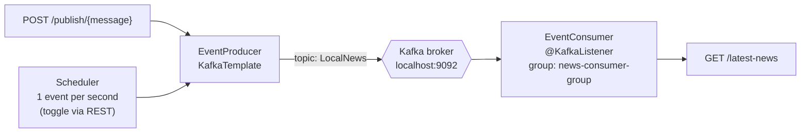

# Apache Kafka Demo

A small Spring Boot app that shows the full Kafka producer/consumer loop end to end. Messages are published to a topic over REST or by a scheduled generator, consumed by a listener in the same app, and shown on a "Latest Local News" page.


## How it works



- **Producer:** `EventProducer` sends string messages with Spring Kafka's `KafkaTemplate`. A scheduled task, off by default, emits a random generated headline every second.
- **Consumer:** `EventConsumer` listens on the `LocalNews` topic as part of the `news-consumer-group` consumer group and keeps the most recent message.
- **API:** a thin REST controller publishes messages, toggles the scheduler and renders the latest message.

## Run it

**Prerequisites:** JDK 21 and Docker.

```bash
# 1. Start a single-node Kafka broker (KRaft mode) on localhost:9092
docker run -d --name kafka -p 9092:9092 apache/kafka:latest

# 2. Start the app
cd demo
./mvnw spring-boot:run
```

Then try it:

```bash
# Publish a message
curl -X POST "http://localhost:8080/publish/Hello-Kafka"

# See it arrive (open in a browser, or curl)
curl http://localhost:8080/latest-news

# Start the generator, which publishes a random event every second
curl -X POST http://localhost:8080/scheduler/true
curl http://localhost:8080/scheduler/status
curl -X POST http://localhost:8080/scheduler/false
```

## Endpoints

| Method | Path | Description |
|---|---|---|
| `POST` | `/publish/{message}` | Publish a message to the `LocalNews` topic |
| `GET` | `/latest-news` | HTML page showing the latest consumed message |
| `POST` | `/scheduler/{true\|false}` | Start or stop the 1-per-second event generator |
| `GET` | `/scheduler/status` | Whether the generator is running |

## Related

The patterns here, a producer in one service and a consumer in another, are used in a larger context in [Library-System](https://github.com/Muhammad-Jaddoua/Library-System), where user registration events flow between microservices over Kafka.
